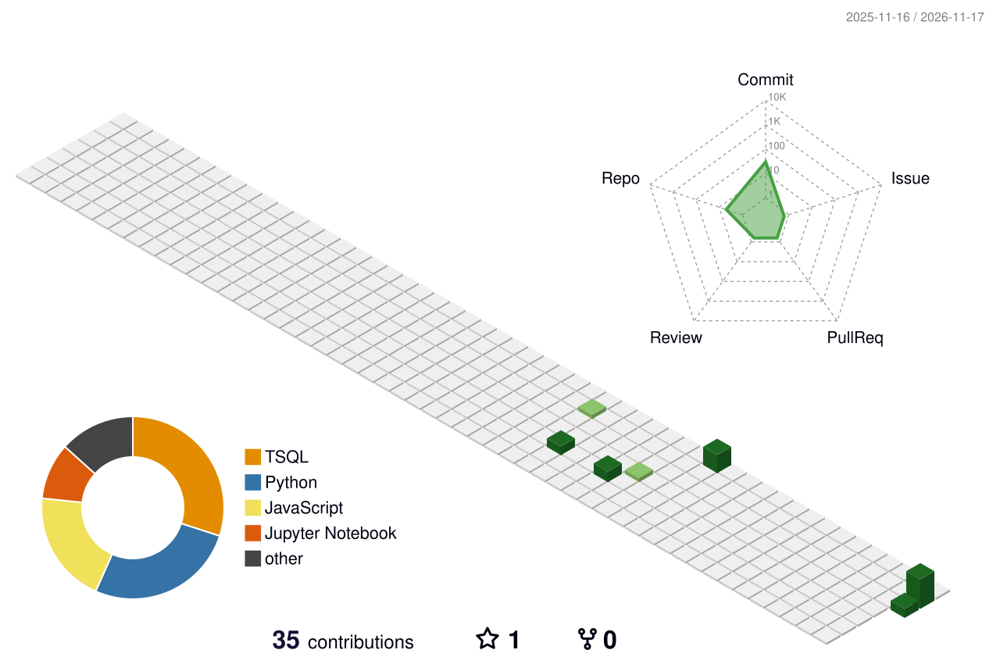

# Hi, I'm Sakith Nishshanka 👋

### 🎓 Data Science Undergraduate at SLIIT | 🤖 Machine Learning & AI | 📊 Business Intelligence

*Building practical solutions with data, machine learning, and full-stack development.*

---

## 👨‍💻 About Me

- 🎓 Studying **BSc (Hons) in Information Technology, specializing in Data Science**, at **SLIIT**.
- 🔍 Interested in **data analytics, machine learning, artificial intelligence, and business intelligence**.
- 🛠️ Experienced in academic projects involving **Python, SQL Server, Power BI, React, Spring Boot, and MongoDB**.
- 🌱 Continuously developing my skills through projects and certifications.
- 📫 Reach me at **sakithnishshankawork@gmail.com**.

## 🧰 Technical Skills

**Programming**  
    

**Data Science & Analytics**  
    

**Development & Databases**  
     

**Tools**  
   

## 🚀 Featured Projects

### ⚽ Football Match Outcome Prediction — Machine Learning
- Developed and evaluated **Logistic Regression, Random Forest, and XGBoost** models using the European Soccer Database.
- Used exploratory analysis, preprocessing, rolling team-form features, and squad ratings to predict **home vs. away wins** (draws excluded).
- 🏆 **Best model: Tuned Random Forest — 71.45% test accuracy.**

### 🏥 Healthcare Data Warehouse & Business Intelligence
- Designed a **SQL Server data warehouse** with fact and dimension tables, ETL processes, and data marts.
- Built **Power BI dashboards** to explore hospital admissions and operational patterns.

### 🪸 Marine Guard — Coral Health Monitoring System
- Built a coral monitoring platform with **React, Spring Boot, and MongoDB**.
- Integrated a **CNN-based ONNX AI service** for coral bleaching classification and severity assessment.
- Supported observations, reports, role-based access, alerts, and case tracking.

### 🛒 Grocery Management System — Mobile Application
- Developed a full-stack shopping app with **React Native (Expo), Node.js, Express, and MongoDB**.
- Implemented customer/admin workflows for inventory, orders, support, and **Stripe payment integration**.

> 📂 Explore my repositories: **[github.com/SakithNishshanka](https://github.com/SakithNishshanka?tab=repositories)**

## 🏅 Certifications

- 🐍 **Data Science Essentials with Python** — Cisco Networking Academy (2026)
- 📊 **Power BI for Beginners** — Simplilearn SkillUp (2026)

## 📈 GitHub Activity

<!-- Optional: Add a 3D contribution image ONLY after the GitHub Actions workflow successfully generates it.

-->

---

**Thanks for visiting! Let's connect and build something useful. 🚀**

