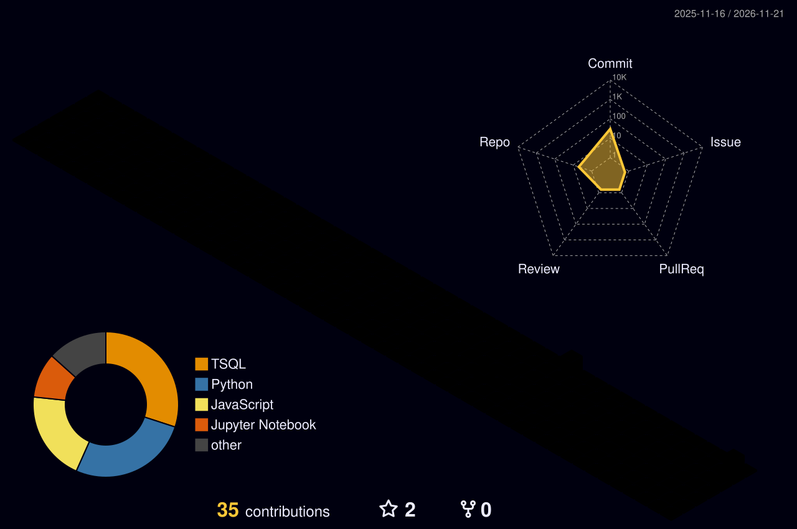

 

  

## 👨‍💻 About Me

I'm a **Data Science undergraduate at the Sri Lanka Institute of Information Technology (SLIIT)**, passionate about applying **machine learning, data analytics, business intelligence, and AI** to real-world problems.

- 🎓 Studying **BSc (Hons) in Information Technology — Data Science specialization**.
- 🔍 Interested in **Machine Learning, Data Analytics, AI, and Data Engineering**.
- 🧠 Working with **Python, SQL, Power BI, and data-driven applications**.
- 🛠️ Also building full-stack applications with **React, React Native, Spring Boot, and Node.js**.
- 📫 Reach me at **sakithnishshankawork@gmail.com**.

## 🧰 Tech Stack

### Data Science & Machine Learning

### Analytics & Databases

### Development & Tools

## 🚀 Featured Projects

| Project | Description | Technologies |
|---|---|---|
| ⚽ **Football Match Outcome Prediction** | Predicts home versus away wins using historical team form, squad ratings, and pre-match features. **Tuned Random Forest: 71.45% test accuracy**. | Python, Pandas, scikit-learn, XGBoost |
| 🏥 **Healthcare Data Warehouse & BI** | SQL Server data warehouse with dimensional modelling, ETL, data marts, and interactive Power BI admissions dashboards. | SQL Server, SSMS, Power BI |
| 🪸 **Marine Guard — Coral Health Monitoring** | Monitors coral bleaching with CNN-based ONNX classification, severity assessment, observations, cases, and alerts. | Spring Boot, React, MongoDB, ONNX |
| 🛒 **Grocery Management System** | Full-stack mobile grocery shopping and administration system with order management, JWT authentication, and Stripe payments. | React Native, Node.js, Express, MongoDB |

> 📌 Explore my repositories below for code, documentation, and demos. Add direct repository links to the project names once their exact URLs are confirmed.

## 📊 GitHub Analytics

  
  
   
  

## 🧊 3D Contribution Calendar

  

> **Setup required:** The 3D calendar is generated by a GitHub Actions workflow. See the instructions below. It will not appear until the workflow has run successfully.

## 🎓 Certifications

- **Data Science Essentials with Python** — Cisco Networking Academy (2026)
- **Power BI for Beginners** — Simplilearn SkillUp (2026)

## 🤝 Let's Connect

I'm always interested in learning, collaborating, and building meaningful data-driven solutions.

📧 **Email:** [sakithnishshankawork@gmail.com](mailto:sakithnishshankawork@gmail.com)  
💼 **LinkedIn:** [linkedin.com/in/sakith-nishshanka](https://linkedin.com/in/sakith-nishshanka)  
💻 **GitHub:** [github.com/SakithNishshanka](https://github.com/SakithNishshanka)

  

